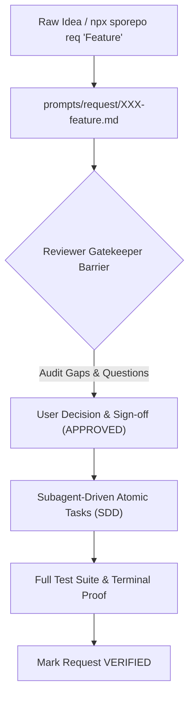
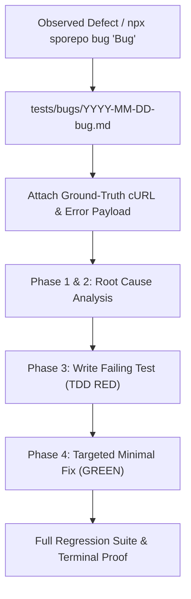

# sporepo

> **AI-Assisted Software Engineering Framework & Zero-Dependency Scaffolding CLI**  
> *A robust hybrid combining context-rich meta-prompting with disciplined engineering workflows.*

[](https://github.com/dimas-sulaksono/sporepo/actions/workflows/ci.yml)
[](https://nodejs.org/)
[](https://opensource.org/licenses/MIT)
[](#zero-dependency)

---

## Overview

**sporepo** bridges the gap between high-context AI meta-prompting and rigorous software engineering execution. It equips AI coding agents and human developers with an automated, zero-dependency framework to design features, systematically eliminate bugs, and maintain verifiable project health.

### Core Principles

1. **Zero Runtime Dependencies:** Built strictly using native Node.js APIs (`fs`, `path`, `child_process`, `crypto`). Operates seamlessly via `npx sporepo` without installing external libraries.
2. **Reviewer Gatekeeper Barrier:** AI agents are strictly instructed to pause and audit specifications for ambiguities, breaking changes, and edge cases before writing implementation code.
3. **Auto-Increment 3-Digit Request Numbering:** Tracks feature prompts with standardized `001-`, `002-` sequences.
4. **The Iron Law of Debugging:** Prohibits symptom patching and speculation. Enforces root-cause discovery, deterministic cURL reproduction, and Test-Driven Development (TDD) failing tests before code fixes.
5. **Terminal-Proven Verification:** Mandates automated test execution and log verification before closing tasks.

---

## Architecture & Workflows

### 1. Feature Request Lifecycle



### 2. Bug Fix Lifecycle



---

## Quick Start

### 1. Initialize a Repository

Inside your project root, run:

```bash
npx sporepo init
```

This creates the standardized structure:
```text
your-project/
├── prompts/
│   ├── README.md
│   └── request/             # Feature specifications (001-*.md)
├── tests/
│   └── bugs/                # Bug reports with cURL and TDD plans
└── .sporepo/
    └── rule.md              # Engineering guidelines for AI agents
```

### 2. Create a Feature Meta-Prompt

To scaffold a new multi-persona feature prompt:

```bash
npx sporepo req "JWT Authentication & Refresh Token"
```

Output:
```text
✔ [sporepo] Meta-Prompt berhasil dibuat: prompts/request/001-jwt-authentication-refresh-token.md
  Nomor Urut      : 001
  Judul Fitur     : JWT Authentication & Refresh Token
```

### 3. Log a Reproducible Bug

To record an issue with deterministic ground-truth evidence:

```bash
npx sporepo bug "Auth 401 on Checkout API"
```

Output:
```text
✔ [sporepo] Laporan Bug berhasil dibuat: tests/bugs/2026-11-17-auth-401-on-checkout-api.md
```

### 4. Audit Repository Compliance

To inspect the engineering status across all features and bug reports:

```bash
npx sporepo audit
```

---

## CLI Command Reference

| Command | Arguments | Description |
| :--- | :--- | :--- |
| `sporepo init` | `[target-dir] [-f]` | Scaffolds `prompts/request/` and `tests/bugs/` directories. |
| `sporepo req` | `<"Title"> [-d dir]` | Generates next 3-digit numbered Meta-Prompt file. |
| `sporepo bug` | `<"Title"> [-d dir]` | Generates timestamped bug report with cURL & TDD structure. |
| `sporepo audit` | `[target-dir]` | Evaluates repository sporepo compliance score and item statuses. |

---

## Global Agent Integration

For workstation-wide enforcement in Google Antigravity or Gemini workspaces:

- **Global Skill:** Copy `skills/sporepo/SKILL.md` to `~/.gemini/config/skills/sporepo/SKILL.md`.
- **Global Rule:** Copy `rules/base-sporepo.md` to `~/.gemini/config/rules/base-sporepo.md`.

---

## Development & Testing

```bash
# Install development dependencies
npm install

# Compile TypeScript
npm run build

# Run native test suite
npm test
```

---

## Contributing

We welcome community contributions! Please review our [Contributing Guide](CONTRIBUTING.md) to learn about our engineering principles, development setup, and PR lifecycle.

---

## License

[MIT](LICENSE) © 2026 Sulaksono
