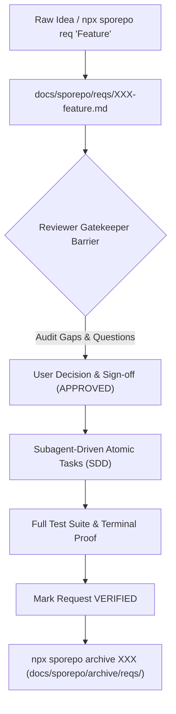
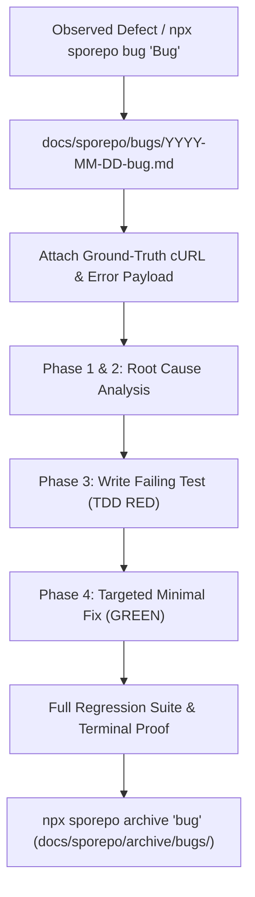

# sporepo

> **AI-Assisted Software Engineering Framework & Zero-Dependency Scaffolding CLI**  
> *A robust hybrid combining context-rich meta-prompting with disciplined engineering workflows.*

[](https://nodejs.org/)
[](https://www.npmjs.com/package/sporepo)
[](https://opensource.org/licenses/MIT)
[](#zero-dependency)

---

## Overview

**sporepo** bridges the gap between high-context AI meta-prompting and rigorous software engineering execution. It equips AI coding agents and human developers with an automated, zero-dependency framework to design features, systematically eliminate bugs, and maintain verifiable project health.

All active specifications, bug investigations, and historical archives are cleanly organized inside `docs/sporepo/` to ensure zero root-directory pollution.

### Core Principles

1. **Zero Runtime Dependencies:** Built strictly using native Node.js APIs (`fs`, `path`, `child_process`, `crypto`). Operates seamlessly via `npx sporepo` without installing external libraries.
2. **Docs-Centric Workspace Hygiene (`docs/sporepo/`):** Isolates all engineering artifacts inside `docs/sporepo/` (`reqs/`, `bugs/`, and `archive/`).
3. **Reviewer Gatekeeper Barrier:** AI agents are strictly instructed to pause and audit specifications for ambiguities, breaking changes, and edge cases before writing implementation code.
4. **Lifecycle Archiving (`archive/`):** Completed tasks (`VERIFIED`) can be cleanly archived (`npx sporepo archive`) while maintaining continuous 3-digit auto-increment sequence numbers.
5. **The Iron Law of Debugging:** Prohibits symptom patching and speculation. Enforces root-cause discovery, deterministic cURL reproduction, and Test-Driven Development (TDD) failing tests before code fixes.
6. **Subagent-Driven Development (SDD):** Orchestrates tasks atomically with fresh implementer and reviewer subagents per task to eliminate context pollution and amnesia.
7. **Terminal-Proven Verification:** Mandates automated test execution and log verification before closing tasks.

---

## Architecture & Workflows

### 1. Feature Request Lifecycle



### 2. Bug Fix Lifecycle



---

## Quick Start

### 1. Initialize a Repository

Inside your project root, run:

```bash
npx sporepo init
```

This creates the standardized structure:
```text
your-project/
├── docs/
│   └── sporepo/
│       ├── README.md
│       ├── reqs/            # Active feature specifications (001-*.md)
│       ├── bugs/            # Active bug reports with cURL and TDD plans
│       └── archive/         # Completed tasks (reqs/ & bugs/)
└── .sporepo/
    └── rule.md              # Engineering guidelines for AI agents
```

### 2. Create a Feature Meta-Prompt

To scaffold a new multi-persona feature prompt:

```bash
npx sporepo req "JWT Authentication & Refresh Token"
```

Output:
```text
✔ [sporepo] Meta-Prompt berhasil dibuat: docs/sporepo/reqs/001-jwt-authentication-refresh-token.md
  Nomor Urut      : 001
  Judul Fitur     : JWT Authentication & Refresh Token
```

### 3. Log a Reproducible Bug

To record an issue with deterministic ground-truth evidence:

```bash
npx sporepo bug "Auth 401 on Checkout API"
```

Output:
```text
✔ [sporepo] Laporan Bug berhasil dibuat: docs/sporepo/bugs/2026-11-17-auth-401-on-checkout-api.md
```

### 4. Archive Completed Work

To move verified features or resolved bugs to the archive:

```bash
# Archive a specific ID
npx sporepo archive 001

# Or archive all items marked [VERIFIED]
npx sporepo archive --all-verified
```

### 5. Migrate Legacy Repositories

If you have an existing repository using the older `prompts/request/` and `tests/bugs/` layout:

```bash
npx sporepo migrate
```

### 6. Audit Repository Compliance

To inspect the engineering status across all features, bugs, and archives:

```bash
npx sporepo audit
```

---

## CLI Command Reference

| Command | Arguments | Description |
| :--- | :--- | :--- |
| `sporepo init` | `[target-dir] [-f]` | Scaffolds `docs/sporepo/` (`reqs`, `bugs`, `archive`) and `.sporepo/`. |
| `sporepo req` | `<"Title"> [-d dir]` | Generates next 3-digit numbered Meta-Prompt in `docs/sporepo/reqs/`. |
| `sporepo bug` | `<"Title"> [-d dir]` | Generates timestamped bug report in `docs/sporepo/bugs/`. |
| `sporepo check` | `[file] [--all] [--json]` | Audits Meta-Prompt specification maturity & barrier sign-off (alias: `gatekeeper`). |
| `sporepo sdd` | `<init \| brief \| pack \| parse>` | Orchestrates Subagent-Driven Development with zero context pollution. |
| `sporepo archive` | `<id \| -a> [-d dir]` | Moves verified items to `docs/sporepo/archive/`. |
| `sporepo migrate` | `[target-dir]` | Safely migrates legacy `prompts/` and `tests/bugs/` to `docs/sporepo/`. |
| `sporepo audit` | `[target-dir]` | Evaluates repository sporepo compliance score, items, and pending archives. |

---

## Global Agent Integration

For workstation-wide enforcement in Google Antigravity or Gemini workspaces:

- **Global Skills:**
  - Copy `skills/sporepo/SKILL.md` to `~/.gemini/config/skills/sporepo/SKILL.md`.
  - Copy `skills/sporepo-gatekeeper/SKILL.md` to `~/.gemini/config/skills/sporepo-gatekeeper/SKILL.md`.
  - Copy `skills/sporepo-sdd/SKILL.md` to `~/.gemini/config/skills/sporepo-sdd/SKILL.md`.
- **Global Rule:** Copy `rules/base-sporepo.md` to `~/.gemini/config/rules/base-sporepo.md`.

---

## Development & Testing

```bash
# Install development dependencies
npm install

# Compile TypeScript
npm run build

# Run native test suite (47 tests)
npm test
```

---

## License

[MIT](LICENSE) © 2026 Sulaksono
