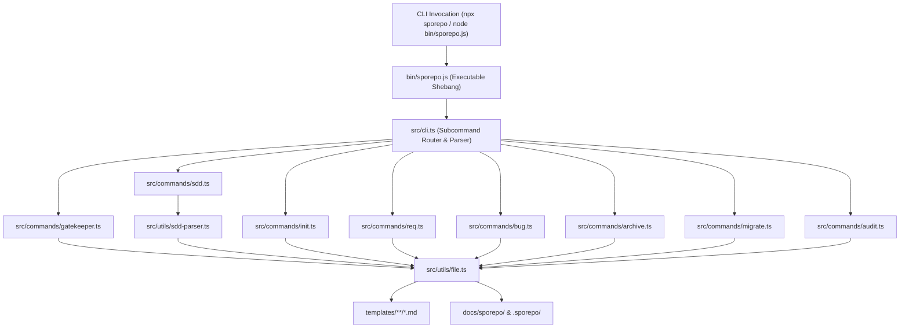

# Arsitektur Teknis sporepo

Spesifikasi desain arsitektur internal, struktur modul, dan sistem template **sporepo v1.1.0**.

---

## 1. Prinsip Desain Utama

| Prinsip | Implementasi |
| :--- | :--- |
| **Zero-Dependency Core** | Runtime murni menggunakan pustaka bawaan Node.js (`fs`, `path`, `child_process`, `crypto`). `dependencies` di `package.json` tetap `{}`. |
| **Context-Rich Meta-Prompting** | Struktur spesifikasi multi-persona dengan batasan file ownership (`Touch Boundaries`) dan gerbang Reviewer Gatekeeper. |
| **Superpowers Discipline** | Wajib TDD (Red-Green-Refactor), investigasi bug dengan ground-truth bukti cURL, dan verifikasi terminal wajib sebelum pekerjaan dianggap selesai. |
| **Terpusat di `docs/sporepo/`** | Seluruh artefak rekayasa (`reqs/`, `bugs/`, `archive/`) terkonsentrasi di dalam `docs/sporepo/` agar root workspace tetap bersih. |

---

## 2. Struktur Modul & Diagram Alur

### Matriks Tanggung Jawab Modul

| Modul | Path | Tanggung Jawab |
| :--- | :--- | :--- |
| **Entrypoint** | `bin/sporepo.js` | Executable wrapper (`chmod 0755`), mendeteksi runtime `dist/src/cli.js`, meneruskan argumen. |
| **Command Router** | `src/cli.ts` | Parsing argumen CLI zero-dependency, penanganan `--help`, `--version`, dan routing perintah. |
| **Init** | `src/commands/init.ts` | Perancah `docs/sporepo/{reqs,bugs,archive}`, `.sporepo/rule.md`, dan panduan markdown. |
| **Request** | `src/commands/req.ts` | Kalkulasi nomor urut 3-digit auto-increment, slugify judul, render template meta-prompt. |
| **Bug** | `src/commands/bug.ts` | Format tanggal ISO `YYYY-MM-DD`, resolusi tabrakan nama (`-2.md`), render template bug report. |
| **Gatekeeper** | `src/commands/gatekeeper.ts` | Linter audit spesifikasi 5-lensa, verifikasi barrier sign-off, kalkulasi maturity score (0-100). |
| **SDD Engine** | `src/commands/sdd.ts` | Subagent-Driven Development: parsing task, inisiasi ledger status per-commit, ekstraksi brief, packaging diff. |
| **Archive** | `src/commands/archive.ts` | Pemindahan item `VERIFIED` ke `docs/sporepo/archive/`, mendukung `--all-verified`. |
| **Migrate** | `src/commands/migrate.ts` | Migrasi aman layout legacy (`prompts/request/` & `tests/bugs/`) ke `docs/sporepo/`. |
| **Audit** | `src/commands/audit.ts` | Pemindaian kesehatan repositori, kepatuhan struktur sporepo, dan evaluasi skor (0-100). |
| **SDD Parser** | `src/utils/sdd-parser.ts` | Parser metadata Meta-Prompt, ekstraksi Touch Boundaries, parsing task atomik, generator isolated brief. |
| **File Utils** | `src/utils/file.ts` | Sanitasi slug, traversal direktori aman, resolusi path, dan template engine deterministik. |

---

## 3. Sistem Template & Variabel

Template di `templates/` menggunakan interpolasi deterministik:
- `templates/meta-prompt.md`: Kerangka spesifikasi fitur dengan multi-persona, touch boundaries, gatekeeper barrier, dan SDD tasks.
- `templates/bug-report.md`: Kerangka investigasi bug dengan metadata lingkungan, cURL ground-truth, dan 4 fase Systematic Debugging.
- `templates/sporepo-rule.md`: Template aturan kerja AI Agent untuk `.sporepo/rule.md`.

| Variabel | Format / Contoh | Keterangan |
| :--- | :--- | :--- |
| `{{ID}}` | `001`, `002`, `010` | Nomor urut 3-digit (auto-increment dari `reqs/` + `archive/`). |
| `{{TITLE}}` | `"Payment Gateway OVO"` | Judul asli fitur atau temuan bug. |
| `{{DATE}}` | `YYYY-MM-DD` | Tanggal lokal pembuatan berkas. |
| `{{SLUG}}` | `payment-gateway-ovo` | Judul yang disanitasi menjadi URL-safe kebab-case. |

---

## 4. Mekanisme Keamanan & Integritas File

1. **Path Traversal Protection:** Resolusi direktori menggunakan `path.resolve()` yang divalidasi terhadap root workspace aktif untuk mencegah directory escape.
2. **Collision-Safe Bug Naming:** Jika berkas `docs/sporepo/bugs/YYYY-MM-DD-slug.md` sudah ada, otomatis menambahkan counter (`-2.md`, `-3.md`) tanpa menimpa data historis.
3. **Idempotent Scaffolding:** `sporepo init` tidak menimpa konfigurasi yang telah dimodifikasi pengguna kecuali menyertakan flag `--force` (`-f`).
