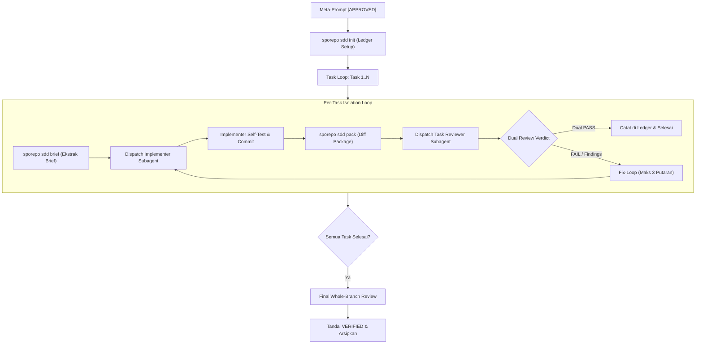

# Panduan Orkestrasi sporepo-sdd (Subagent-Driven Development)

Dokumen ini menjelaskan arsitektur, peran koordinator, protokol subagent terisolasi, dan penggunaan CLI untuk modul **sporepo-sdd**.

---

## 1. Konsep & Filosofi (*The Conductor Protocol*)

**sporepo-sdd** mengadaptasi metodologi Subagent-Driven Development untuk memastikan eksekusi rencana tugas (*implementation plan*) berlangsung tanpa pembengkakan konteks (*zero context pollution*) dan dengan penjaminan mutu berlapis.

### Diagram Alur Orkestrasi SDD



---

## 2. Aturan Emas Koordinator (*The Golden Rules*)

1. **Koordinator Adalah Konduktor:** Agen induk dilarang mengotori konteksnya dengan menulis kode implementasi secara langsung.
2. **Eksekusi Berkesinambungan (*Continuous Execution*):** Tidak berhenti di antara tugas untuk meminta izin sepele. Rencana dieksekusi secara berurutan hingga tuntas.
3. **Keputusan Sepihak (*Rulings, Not Stalls*):** Selesaikan ambiguitas minor dengan keputusan profesional, catat di ledger:
   `Ruling: <keputusan> — <alasan> — <biaya jika salah>`.
4. **Hanya 4 Hal yang Menghentikan Koordinator:**
   - Operasi destruktif tak terpulihkan.
   - Kredensial rahasia pengguna.
   - Aksi luar repositori (`git push`, publish).
   - Rencana rusak total.

---

## 3. Penggunaan Antarmuka Baris Perintah (CLI)

### A. Inisiasi Sesi SDD (`sporepo sdd init`)
```bash
npx sporepo sdd init docs/sporepo/reqs/XXX-nama-fitur.md
```
Menghasilkan berkas ledger di `.scratch/sdd/<id>/ledger.md` yang memuat peta tugas dan base commit.

### B. Ekstrak Brief Tugas (`sporepo sdd brief`)
```bash
# Ekstrak brief untuk Task 1
npx sporepo sdd brief docs/sporepo/reqs/XXX-nama-fitur.md 1

# Opsi kustomisasi output
npx sporepo sdd brief docs/sporepo/reqs/XXX-nama-fitur.md 1 --out .scratch/sdd/003/custom-brief.md
```
Menghasilkan berkas instruksi mandiri bebas context pollution yang siap diberikan ke Implementer Subagent.

### C. Pembuatan Paket Diff Reviewer (`sporepo sdd pack`)
```bash
# Paketkan commit dari BASE ke HEAD
npx sporepo sdd pack <base-commit> HEAD
```
Menghasilkan ringkasan commit log, git stat, dan unified diff `-U10` yang terisolasi dalam satu berkas markdown untuk Task Reviewer.

### D. Ringkasan Tugas (`sporepo sdd parse`)
```bash
npx sporepo sdd parse docs/sporepo/reqs/XXX-nama-fitur.md
```
Menampilkan status centang tugas atomik, batasan kepemilikan file, dan persona terkait.

---

## 4. Dua Lensa Peninjauan Mutlak (*Dual Review Lenses*)

Setiap Task Reviewer subagent mengevaluasi:
1. **Spec Compliance:** Memastikan seluruh deliverable dan nilai verbatim dari brief telah dipenuhi tanpa deviasi.
2. **Code Quality:**
   - Memastikan kepatuhan Zero-Dependency (0 runtime packages baru).
   - Kualitas automated test (TDD passing).
   - Kebersihan kode (YAGNI, tidak ada refactor liar di luar brief).
