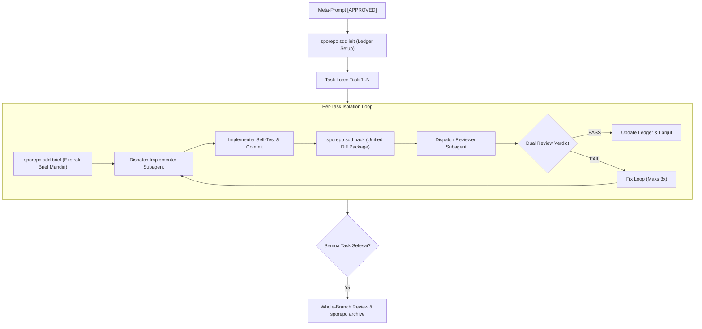

# Panduan Orkestrasi sporepo-sdd

Orkestrasi Subagent-Driven Development (SDD): protokol konduktor, brief terisolasi, dan review diff berpasangan.

---

## 1. Siklus Orkestrasi SDD

---

## 2. Aturan Emas Koordinator (*The Conductor Protocol*)

1. **Koordinator Adalah Konduktor:** Jangan mengotori konteks agen induk dengan menulis kode implementasi secara langsung saat orkestrasi besar berlangsung.
2. **Eksekusi Kontinu (*Continuous Execution*):** Jangan berhenti di antara tugas untuk meminta izin sepele. Eksekusi tugas atomik secara berurutan.
3. **Ruling Mandiri (*Rulings, Not Stalls*):** Selesaikan ambiguitas minor dengan keputusan profesional, catat di ledger:
   `Ruling: <keputusan> — <alasan> — <biaya jika salah>`.
4. **Hanya 4 Kondisi yang Menghentikan Koordinator:**
   - Operasi destruktif tak terpulihkan.
   - Kebutuhan rahasia/kredensial pengguna.
   - Aksi di luar repositori (`git push`, `npm publish`).
   - Rencana rusak total / blocking arsitektural.

---

## 3. Perintah CLI SDD

| Perintah | Sintaks | Output & Keterangan |
| :--- | :--- | :--- |
| **`init`** | `npx sporepo sdd init <file.md>` | Membuat buku besar `.scratch/sdd/<id>/ledger.md`, mencatat base commit, dan mendaftar peta seluruh tugas. |
| **`brief`** | `npx sporepo sdd brief <file.md> <task-no>` | Mengekstrak instruksi mandiri ke `.scratch/sdd/<id>/task-N-brief.md` tanpa membocorkan riwayat percakapan. |
| **`pack`** | `npx sporepo sdd pack <base-sha> [head-sha]` | Mengumpulkan commit log, per-file diff stat, dan unified diff `-U10` ke berkas review package markdown. |
| **`parse`** | `npx sporepo sdd parse <file.md>` | Menampilkan ringkasan persona, status checklist tugas, dan daftar file batasan (*Touch Boundaries*). |

---

## 4. Dua Lensa Review Wajib (*Dual Review Lenses*)

Setiap reviewer subagent wajib memvalidasi dua kriteria sebelum tugas diberi stempel **PASS**:

1. **Spec Compliance:** Memastikan seluruh deliverable, acceptance criteria, dan instruksi spesifik pada brief terpenuhi tanpa deviasi atau asumsi sepihak.
2. **Code Quality & Zero-Dependency:**
   - Zero-dependency: Tidak ada penambahan runtime package baru pada `package.json`.
   - TDD: Test suite bertambah dan lulus 100% (`npm test`).
   - Kebersihan kode: Tidak ada refactor liar di luar batas berkas yang diizinkan (*Allowed Files*).
